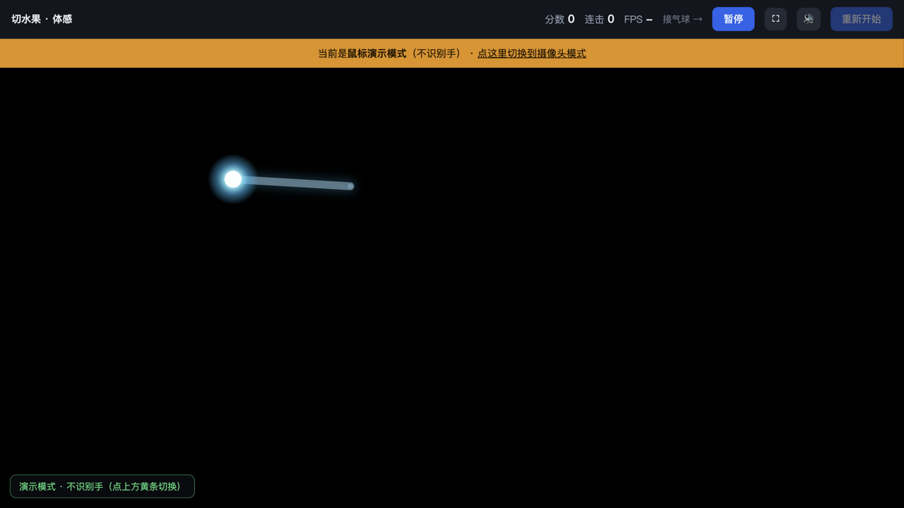

# 体感小游戏（摄像头 + MediaPipe）

两个用电脑摄像头直接玩的体感小游戏，纯前端实现，**完全本地运行、不联网、不上传画面**。

| 游戏 | 玩法 |
|---|---|
| 🎈 **接气球** | 双手位置控制篮子，接住落下的气球，40 秒一局 |
| 🔪 **切水果** | 手掌变成发光圆点，挥动切水果；炸弹扣分，无限模式随时暂停 |



## 快速开始

```bash
# 需要 Python 3（仅用于起一个静态服务器，带正确的 .mjs / .wasm MIME）
python3 serve.py
```

然后浏览器打开 **http://127.0.0.1:8790**

- 接气球：<http://127.0.0.1:8790/>
- 切水果：<http://127.0.0.1:8790/fruit.html>
- 切水果（鼠标演示，不需要摄像头）：<http://127.0.0.1:8790/fruit.html?demo=1>

> 摄像头需要"安全上下文"：`http://127.0.0.1` 或 `http://localhost` 可以直接用；手机通过局域网 IP 访问时浏览器会拒绝摄像头，需要 HTTPS 隧道（例如 `cloudflared tunnel --url http://127.0.0.1:8790`）。

## 操作

**接气球**：双手抬到胸前，用身体左右移动 → 篮子跟着手走。

**切水果**：

- 手进入画面后变成**发光圆点**，挥动时拖出光带，**光带碰到水果就切开**（判定很宽松）
- 炸弹：扣 5 分并打断连击，不会结束游戏
- 漏掉水果：只断连击，**无限模式不会结束**
- 空格键 = 暂停/继续，F 键 = 全屏，右上角也有对应按钮

## 技术实现

- **MediaPipe Tasks Vision**（WASM + WebGL/GPU 委派），完全本地化，无需 CDN
- 接气球：`PoseLandmarker`（lite，33 个身体关节点）
- 切水果：`HandLandmarker`（21 个手部关节点，最多 2 只手）
- 切中判定：把拖尾点序列化成线段，与水果圆做**线段-圆相交**，半径 = 水果半径 + 26px；不要求手速，静止也能切到飞近的水果
- 画面用 `<canvas>` 叠加在镜像的 `<video>` 上，背景视频半透明，骨架/圆点/光带全部程序绘制，无图片素材
- 音效由 WebAudio 实时合成（切割、爆炸、漏接），无音频文件
- 视觉模型不参与实时判断——动作捕捉用的是毫秒级的小模型，不是大语言模型

## 目录结构

```
.
├── index.html              # 接气球
├── fruit.html              # 切水果
├── serve.py                # 静态服务器（正确的 .mjs/.wasm MIME）
├── vision_bundle.mjs       # MediaPipe Tasks Vision 运行时
├── wasm/                   # MediaPipe WASM（SIMD / 非 SIMD）
├── models/
│   ├── pose_landmarker_lite.task   # 姿态模型 5.5MB
│   └── hand_landmarker.task        # 手部模型 7.5MB
└── docs/preview.png
```

## 硬件与姿势建议

- MacBook 自带 720p 摄像头即可，30fps 左右
- 单人；切水果站 1~1.5 米，接气球站 1.5~2 米
- 光线要足、避免逆光；手掌朝向镜头时手部检测最稳
- 部分应用内嵌浏览器（WebView）拿不到摄像头权限，请用 Safari / Chrome 打开

## 致谢

- [MediaPipe](https://github.com/google-ai-edge/mediapipe)（Apache-2.0）提供姿态与手部模型
- 模型文件来自 `storage.googleapis.com/mediapipe-models`，运行时来自 npm `@mediapipe/tasks-vision@0.10.14`
